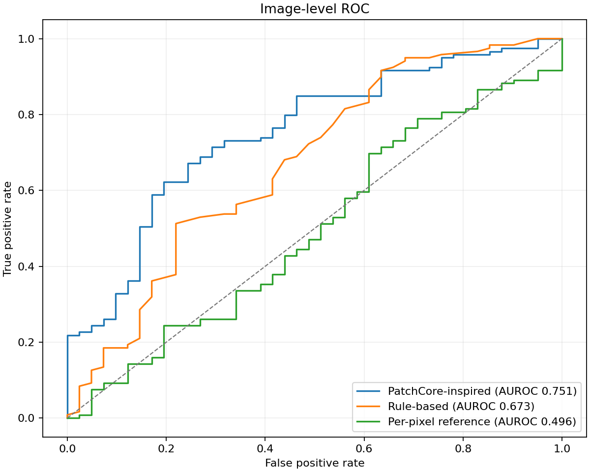
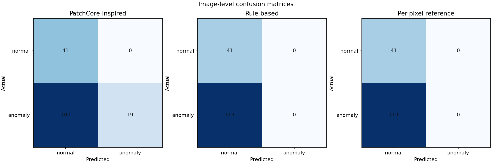

# Results

## Primary experiment: screw

The patch detector and two classical baselines were evaluated on the full MVTec AD screw test split: 160 images (41 normal and 119 anomalous), with no missing anomaly masks. Thresholds were selected using 48 held-out normal training images. Pixel metrics use the evaluator's common 256×256 grid.

### Image-level detection

| Method | AUROC | Precision | Recall | F1 |
| --- | ---: | ---: | ---: | ---: |
| Patch-memory detector | 0.7510 | 1.0000 | 0.1597 | 0.2754 |
| Rule-based local contrast | 0.6729 | 0.0000 | 0.0000 | 0.0000 |
| Per-pixel normal reference | 0.4960 | 0.0000 | 0.0000 | 0.0000 |

At its calibrated image threshold, the patch detector labeled 19 of 119 anomalous test images as anomalous and produced no false positives among the 41 normal images. The two baseline thresholds did not label any test image anomalous. This is why the AUROC values should not be presented alone.

All three methods were timed on CPU after three warm-up images. Mean total time per image was 116.4 ms for the patch detector, 55.6 ms for the rule-based baseline, and 96.0 ms for the per-pixel reference. These timings depend on the machine and software environment.

### Pixel-level localization

| Method | AUROC | Precision | Recall | F1 |
| --- | ---: | ---: | ---: | ---: |
| Patch-memory detector | 0.9825 | 0.1057 | 0.6797 | 0.1830 |
| Rule-based local contrast | 0.8669 | 0.0271 | 0.5079 | 0.0515 |
| Per-pixel normal reference | 0.6988 | 0.0274 | 0.0826 | 0.0411 |

The detector's pixel ranking is strong on this test split, but its thresholded mask has low precision. It marks many pixels outside the ground-truth defect masks. AUROC reflects ranking across thresholds; it does not imply good performance at the selected operating threshold.

The ranked failure examples are generated under outputs/examples/screw/research/. Their visual causes require human inspection; the report does not infer defect causes automatically.

## Secondary experiment: bottle

The bottle category was evaluated separately on 83 test images (20 normal and 63 anomalous), also with complete mask coverage.

| Method | Image AUROC | Image F1 | Pixel AUROC | Pixel F1 |
| --- | ---: | ---: | ---: | ---: |
| Patch-memory detector | 1.0000 | 0.9921 | 0.9826 | 0.5010 |
| Rule-based local contrast | 0.7524 | 0.3750 | 0.6203 | 0.1166 |
| Per-pixel normal reference | 0.9675 | 0.8649 | 0.8451 | 0.4977 |

The MVTec bottle category uses a close-up inspection framing rather than a full beverage-bottle view. The screw experiment is therefore the primary demonstration category.

## Run artifacts and interpretation

The full machine-readable reports, per-image CSVs, metadata, sweep results, and remaining plots are generated under outputs/metrics/, outputs/plots/, and outputs/examples/. Those generated directories are ignored by Git because they are reproducible local artifacts. The figures linked above are selected copies for the project report.

These are results from this project's evaluator and local artifacts. They are not official MVTec benchmark scores and should not be generalized beyond these dataset splits.